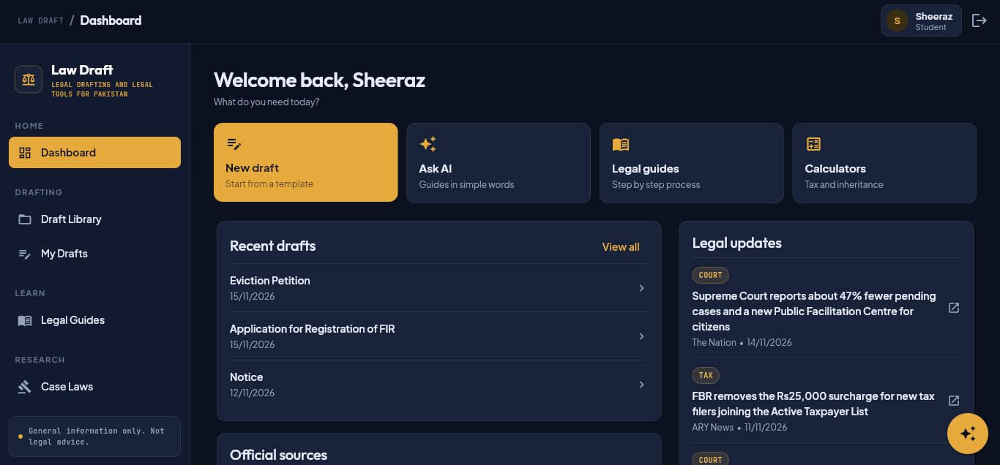
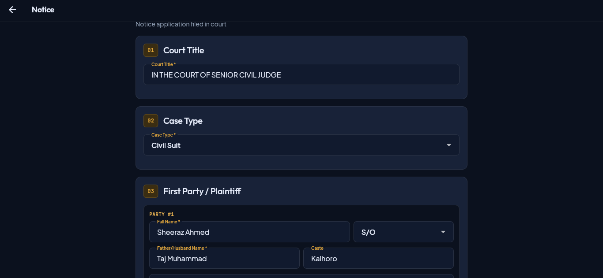
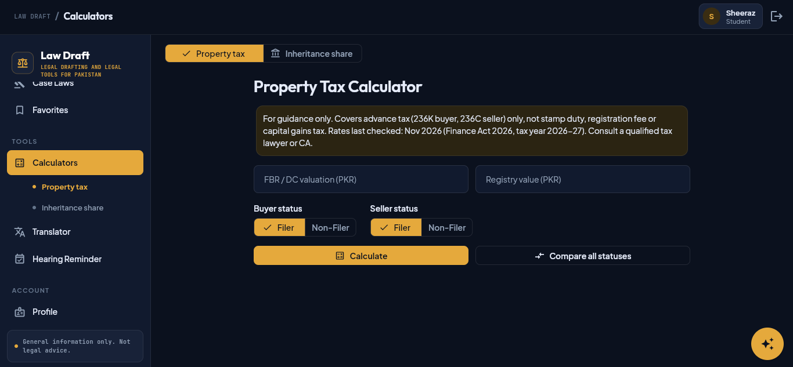
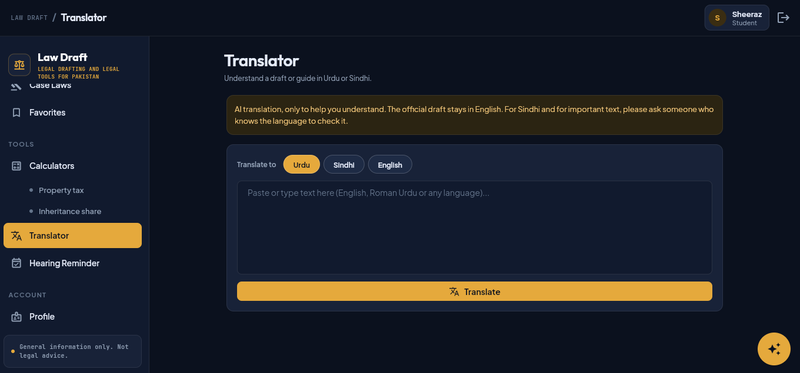

# Law Draft

A free legal drafting and legal information app for Pakistan, built as a final year project.
One Flutter codebase runs on the **web** and on **Android**.

> **Disclaimer:** Law Draft gives general information only, not legal advice. All draft wording is
> sample text and must be checked by an advocate before use. AI translations and explanations can
> contain mistakes.

---

## Why this project

Many people in Pakistan do not know which legal paper they need, what the court process looks like,
or how to read it in English. Law Draft puts the common drafts, step by step guides, calculators and
translation in one app that is free, works on a phone, and keeps working (for guides and drafts) with
a weak or no internet connection.

## Screenshots

| Dashboard | Draft form | Ask AI |
|---|---|---|
|  |  |  |

| Property Tax Calculator | Translator |
|---|---|
|  |  |

## Features

**Drafting**
- 25 legal drafts across Family, Civil, Criminal, Bail, Rent and Constitutional matters, plus
  affidavit, power of attorney, legal notice and more.
- Guided forms (parties, dates, one-point-per-line fields), preview, and download as an editable **DOCX**.
- Draft history ("My Drafts") with re-download.
- Drafts are **data, not code**: each draft is a JSON card in Supabase, so new drafts are added with SQL
  and appear on web and Android without rebuilding the app.

**Learning and research**
- **Legal Guides:** step by step processes (for example FIR, Khula, bail, tenant eviction), with a
  "verified by" badge and links to the related drafts. Works offline after the first load.
- **Instant local search** in English, Roman Urdu and Urdu script (keywords per guide, typo tolerant).
- **Ask AI** in three levels:
  1. instant answer from the saved guides (works offline),
  2. optional AI explanation, grounded in the matched guides only,
  3. optional web search that opens in the user's own browser.
- **Case law notes** with a link to the official judgment (summaries are short notes, not the judgment).
- **Dashboard** with recent drafts, legal updates (headlines with links) and official sources.

**Tools**
- **Islamic inheritance calculator** (Hanafi rules: fixed shares, residuary heirs, awl, radd).
- **Property advance tax calculator** (sections 236K and 236C). Rates live in one file with a
  "last checked" date.
- **Translator:** English, Urdu and Sindhi, from a draft, a guide or typed text.
- **Read aloud, share on WhatsApp, voice input** (Urdu and English, depends on the phone).
- **Hearing reminder:** adds the hearing to the phone calendar (Google Calendar link or `.ics` file).

**Quality**
- Dark, responsive UI: sidebar on desktop, bottom navigation and drawer on phones.
- Unit tests for the calculators, the draft renderer, the local search and the calendar file.

---

## Tech stack

| Layer | Technology |
|---|---|
| App | Flutter (Dart), Material 3, one codebase for web and Android |
| Backend | Supabase: Auth, PostgreSQL with Row Level Security, Edge Functions |
| AI | Groq (main) and Gemini (fallback), called **only from Edge Functions** |
| Documents | DOCX generated in the app (zip of XML, no server) |
| Offline | `shared_preferences` cache for guides and draft templates |
| Device features | `share_plus`, `url_launcher`, `flutter_tts`, `speech_to_text`, `file_saver` |

## How it works

```
Flutter app (web / Android)
   |-- Supabase Auth ........... login, session
   |-- PostgREST + RLS ......... guides, case laws, drafts history, templates, updates
   |-- Edge Function guide-chat  ---> Groq (fallback: Gemini)   answers from saved guides
   |-- Edge Function translate   ---> Groq (fallback: Gemini)   Urdu / Sindhi / English
   `-- Local cache ............. guides and draft templates (offline), local keyword search
```

**Draft cards.** A draft is one row in `draft_templates`:
- `form`: sections and fields (`text`, `multiline`, `dropdown`, `date`, `parties`),
- `document`: lines of text with `{placeholders}`.

| Document key | Meaning |
|---|---|
| `"t"` | text of the line; `{key}` is a form value, `{key\|upper}`, `{party.type}`, `{party.name}`, `{item}` |
| `"b"`, `"u"` | bold, underline |
| `"a"` | alignment: `c` center, `r` right, `j` justify |
| `"n": true` | numbered paragraph |
| `"if": "key"` | show the line only if the field is filled (`"key=Value"` for a dropdown value) |
| `"each": "key"` | one line per line of a multiline field |
| `"parties": "key"` | the full party block |
| `"blank": true` | empty line |

---

## Project structure

```
lib/
  core/        theme, colors, tax rates, app info, config flags
  models/      data classes (guides, case laws, drafts, profile ...)
  services/    Supabase access, draft engine, calculators, search, translate, speech, sharing
  screens/     one file per screen
  widgets/     app shell (sidebar, navigation), dynamic form, shared UI parts
supabase/
  schema.sql   tables, policies and functions (reference copy of the database setup)
  functions/   Edge Functions: guide-chat, translate
test/          unit tests
assets/fonts/  Outfit, Plus Jakarta Sans, JetBrains Mono
```

## Database (Supabase)

`profiles`, `case_laws`, `favorites`, `generated_drafts`, `legal_guides`, `legal_updates`,
`draft_templates`. Every table has **Row Level Security**: users can only read or change their own
profile, favorites and draft history. See `supabase/schema.sql`.

---

## Getting started

**Requirements:** Flutter SDK, a Supabase project (free tier), Android Studio for the Android build.

1. Clone the repository and run `flutter pub get`.
2. Download the fonts listed in `pubspec.yaml` into `assets/fonts/`.
3. In the Supabase SQL editor run `supabase/schema.sql`. Turn off "Confirm email" under
   Authentication, Providers, Email if you want instant sign up while testing.
4. Create `lib/core/supabase_config.dart` with your project URL and **anon** key:
   ```dart
   class SupabaseConfig {
     static const url = 'https://YOUR-PROJECT.supabase.co';
     static const anonKey = 'YOUR-ANON-KEY';
   }
   ```
5. Deploy the Edge Functions in `supabase/functions/` (keep "Verify JWT" on) and add these secrets:
   `GROQ_API_KEY`, `GROQ_MODEL`, `GEMINI_API_KEY`, `GEMINI_MODEL`.
6. Add content: drafts (`draft_templates`), guides (`legal_guides`), case laws and updates, with SQL
   or the Supabase table editor.
7. Run:
   ```
   flutter run -d chrome        # web
   flutter run                  # Android phone (USB debugging on)
   ```

**Tests:** `flutter test`

**Release builds**
```
flutter build web --release      # upload build/web to any static host
flutter build apk --release      # build/app/outputs/flutter-apk/app-release.apk
```
The Android build needs the `INTERNET` and `RECORD_AUDIO` permissions and the `queries` entries
for `https`, text-to-speech and speech recognition in `AndroidManifest.xml`.

---

## Security and privacy

- API keys for the AI services exist **only as Supabase secrets**; the app never contains them.
- The Supabase **anon key** in the app is public by design; data is protected by Row Level Security.
  Never put a `service_role` key in the app or in the repository.
- The Edge Functions require a logged in user (JWT verification on).
- Users are asked not to type real names, CNIC or phone numbers into the AI features, because that
  text is sent to an AI service. Voice input uses the phone's own speech recognition.

## Data and sources

- Guides and drafts are **sample content** until an advocate reviews them. Each guide shows a
  "not yet verified" or "reviewed by" badge.
- Tax rates are in `lib/core/tax_rates.dart` with the date they were last checked. Check the official
  Finance Act and FBR notifications before relying on them.
- Case law entries hold the citation, a short note written in our own words, and a link to the
  official judgment. Judgments themselves are not copied.

## Limitations

- Sindhi translation and Urdu speech recognition quality depend on the AI model and the phone.
- Login, case law search, favorites and draft history need an internet connection.
- The calculators cover common cases only (see the notes on the screens).
- The AI can still make mistakes, so answers are marked as general information.

## Roadmap

- Verified helplines and "know your rights" cards from official sources
- More real judgments with short notes
- Optional app lock (fingerprint or PIN)
- Urdu and Sindhi interface language

## Team

- Developers: Sheeraz Ahmed, Mohsan Ali, Asad Niaz
- Supervisor: Prof. Asia Soomro
- Institution: University of Sindh / Institue of Mathematics & Computer Science (IMCS), 2026

## Acknowledgements

Feature ideas were inspired by existing legal drafting platforms. The code, the UI design and the
draft wording in this project were created for this project, and the draft wording is sample text.
Judgment links point to the official court websites.

## License

All rights reserved
